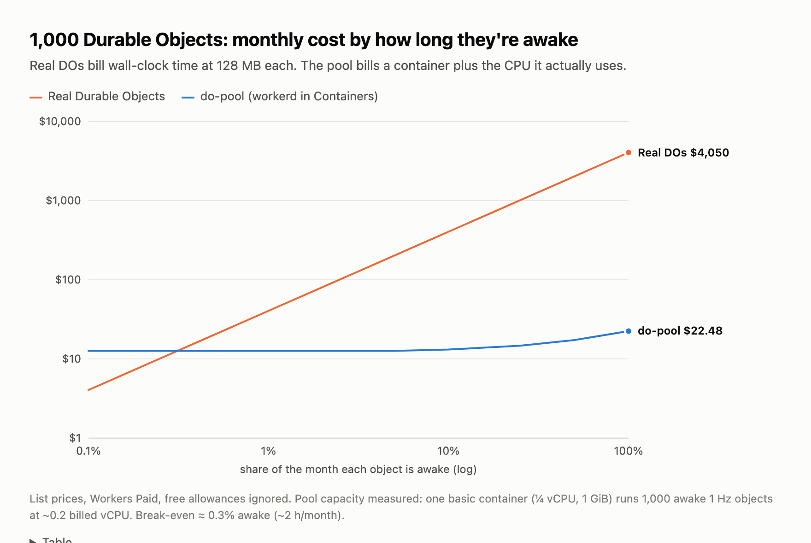

# do-pool: Durable Objects, bin-packed into Cloudflare Containers

Run your Durable Object classes either as **real Durable Objects** or **hundreds-per-container
inside workerd** (Cloudflare's open-source runtime) on Cloudflare Containers. The same class runs
on both sides, behind the same Worker, with the same bindings.

For objects that are awake most of the time but doing little (game loops, presence, agents waiting
on LLMs, upstream feeds), the pool is **~180× cheaper**: 1,000 always-awake objects cost about $22
a month instead of $4,050. Objects that mostly hibernate should stay real DOs. See
[`POST.md`](POST.md) for the write-up and [`bench/results`](bench/results) for the raw data.



Live demo (while it's up): https://do-pool.do-pool-lab.workers.dev. It has two demos (live cursors
and a Yjs editor), each with a backend switch, plus a pool dashboard.

> **v2** ([`docs/v2.md`](docs/v2.md)) adds:
>
> - alarms that survive moves and crashes
> - native `ctx.container` with region-local nodes
> - snapshot sleep/wake
> - Dynamic Workers + facets, with hot code swaps
> - a sandboxed process per tenant app for untrusted code
>
> An API parity suite runs the same assertions against real DOs, pooled DOs, real facets and pooled
> facets. Preview: https://do-pool-v2.do-pool-lab.workers.dev.

| Capability | Real DO | do-pool v1 | do-pool v2 |
|---|---|---|---|
| SQL / KV / transactions / WebSocket hibernation API | ✅ | ✅ | ✅ |
| Alarms (incl. retries) | ✅ | ⚠️ lost on move or crash | ✅ |
| Zero lost writes on planned moves | n/a | ⚠️ rare race | ✅ |
| Write acknowledged after replication | ✅ | ❌ RPO 30 s | ❌ RPO 30 s on hard failure |
| Near its users | ✅ | ❌ | ✅ region-local nodes |
| Scale to zero | ✅ | ⚠️ | ✅ snapshot sleep/wake |
| Dynamic code (Worker Loader + facets), hot swaps | ✅ | ❌ | ✅ |
| Untrusted tenant code | ✅ | ❌ | ✅ process + namespaces per app, in a microVM |
| Point-in-time recovery | ✅ | ❌ | ❌ |

## How it works

```
Browser ──► Worker (edge router, static assets)
              ├─ /do/<class>/<name>    → real Durable Object (same class)
              └─ /pool/<class>/<name>  → Placement.resolve() → PoolNode DO → container
                                                                   │ raw TCP passthrough
            ┌──────────────────────────────────────────────────────▼───────────────┐
            │ Cloudflare Container (basic: ¼ vCPU, 1 GiB)                          │
            │  tini → supervisor.sh ─ stats, periodic flush, drain on SIGTERM      │
            │        → workerd: router worker → CursorRoom / YDoc / Ticker DOs     │
            │                   SQLite per object on local disk                    │
            │  http://bridge.internal ──(outboundByHost)──► Worker: R2, Placement  │
            └──────────────────────────────────────────────────────────────────────┘
```

- **`Placement`** (`src/placement.ts`) is the "load balancer DO". It assigns objects to nodes
  (sticky, least-loaded), scales nodes up and down from pushed CPU and connection stats,
  rebalances hot nodes by live-migrating batches of objects, and fences moves with per-assignment
  epochs.
- **`PoolNode`** (`src/pool-node.ts`) is one per container. It extends `@cloudflare/containers`
  but hands WebSockets to the runtime with `getTcpPort().fetch()` instead of the library's
  JavaScript proxy (see *Gotchas*).
- **`PortableDurableObject`** (`objects/portable.ts`) is the base class for pooled objects. It's
  a no-op on Cloudflare. In the pool it tracks writes, snapshots storage, hydrates from the last
  checkpoint on a fresh disk, and closes sockets with 1012 when the object moves.
- **Checkpoints** (`objects/ckpt-store.ts`): every 30s each node writes **one R2 segment**
  containing every dirty object, plus a per-node manifest. That's 2 PUTs per flush whether 1 or
  1,000 objects changed. A per-object PUT would cost more than the container. A drain on SIGTERM
  (rollout, scale-down, sleep) flushes everything first.
- **The bridge** (`src/bridge.ts`) gives code inside the container access to Worker bindings
  through plain HTTP to `bridge.internal`, intercepted by the Container's outbound handler.

Write classes the usual way, but extend `PortableDurableObject` and put setup in `onStart()`:

```ts
export class Ticker extends PortableDurableObject<PoolEnv> {
  static slug = "ticker";
  protected onStart() {
    this.ctx.storage.sql.exec("CREATE TABLE IF NOT EXISTS counter (id INTEGER PRIMARY KEY, n INTEGER)");
  }
  async fetch(req: Request) { /* ... */ }
}
```

Then register it in `objects/index.ts`, `container/workerd.capnp` and `wrangler.jsonc`.

## Layout

| path | what |
|---|---|
| `src/` | Worker: edge router, `Placement`, `PoolNode`, bridge |
| `objects/` | portable DO classes (`CursorRoom`, `YDoc`, `Ticker`), base class, checkpoint store |
| `container/` | Dockerfile, `workerd.capnp`, in-container router, supervisor, local dev bridge |
| `web/` | demos (cursors, editor), pool dashboard, cost chart |
| `bench/` | load generator, durability/migration tests, analytics + cost model, celld arm, results |
| `spike/` | phase-1 feasibility spike (instance-type and runtime comparisons) |
| `FINDINGS.md` | phase-1 notes |

## Tests

```sh
# API parity: identical assertions against each backend (v2 preview)
BACKENDS=do,pool,do-facet,pool-facet,pool-sbx npm run test:parity
# Pool guarantees (slow): alarms across move/SIGTERM/SIGKILL, zero-loss migration under writes,
# control-plane deploy under load, sleep/wake, facet migration + code swap, sandbox isolation
ADMIN_TOKEN=... npm run test:lifecycle
```

## Run it

```sh
npm install
cp .env.example .env            # CLOUDFLARE_ACCOUNT_ID, CLOUDFLARE_API_TOKEN, ADMIN_TOKEN
npx wrangler r2 bucket create do-pool-checkpoints
npm run deploy                  # v1: builds the container bundle + web, then wrangler deploy
npm run deploy:control          # v2 pool (nodes, Placement, bridge, image); restarts nodes
npm run deploy:preview          # v2 edge Worker; doesn't touch the pool
echo "$ADMIN_TOKEN" | npx wrangler secret put ADMIN_TOKEN
```

Docker must be running: wrangler builds the `linux/amd64` image locally.

To run a node locally without Cloudflare:

```sh
npm run dev:node
docker network create poolnet
docker run -d --name devbridge --network poolnet --network-alias bridge.internal \
  -v $PWD/container/dev-bridge.mjs:/b.mjs node:22-bookworm-slim node /b.mjs
docker run --rm --network poolnet -e NODE_NAME=local -p 8091:8080 do-pool-node:dev
curl -H 'x-do-class: ticker' -H 'x-do-name: t1' localhost:8091/
```

Benchmarks (`ADMIN_TOKEN` must be in your environment for the admin ones):

```sh
npx tsx bench/load.ts --backend pool --cls ticker --rooms 1000 --per 1 --hz 0 --secs 180
npx tsx bench/load.ts --backend do   --cls ticker --rooms 1000 --per 1 --hz 0 --secs 180
npx tsx bench/durability.ts sigterm|sigkill
npx tsx bench/migrate.ts 4
npx tsx bench/analytics.ts <sinceISO> <untilISO>   # billed DO + container usage
npx tsx bench/cost-model.ts
node bench/ui-check.mjs                            # two browser tabs per demo, screenshots
```

Admin API (`Authorization: Bearer $ADMIN_TOKEN`): `POST /api/{add-node,drain?node=,stop-node?node=,kill-node?node=,migrate?key=,reset,config?minNodes=&maxNodes=}`.
`GET /api/status` and `GET /api/node/<node>` are public.

## Gotchas we hit

1. **`@cloudflare/containers` proxies WebSockets in JavaScript inside the fronting DO.** It caps
   out around 1k msg/s, and every container→client frame is billed as an *inbound* DO WebSocket
   message. Return `ctx.container.getTcpPort(port).fetch(url, req)` instead. That raw passthrough
   isn't billed as DO wall-clock time either.
2. **Hard limit: 4,096 concurrent inbound connections per container.** Each proxied WebSocket
   is one, so use many small instances rather than one big one.
3. **`static outboundByHost = {…}` silently does nothing.** The class field shadows the base
   class's static setter. Assign it after the class instead: `PoolNode.outboundByHost = {…}`.
4. **workerd is single-threaded**, and a Cloudflare vCPU is about 4× slower than an M-series
   core on tight JS. Host speed also varies about 1.7× between instances.
5. **permessage-deflate costs about 300 KB per socket** in workerd. Strip
   `Sec-WebSocket-Extensions` and set the `no_web_socket_compression` flag.
6. **A CPU-starved container can't upload its own checkpoints** (bridge requests time out), so
   it can neither persist nor shed objects. Scale before saturation and run workerd under `nice`
   so the supervisor's stats keep flowing.
7. **Containers boot wherever there's capacity.** We got LAX, SJC, IAD, CDG and KIX for clients
   in California. That's part of why pool RTT is higher than for real DOs.
8. **Busy DOs keep running old code for about 5 minutes after a deploy**, so keep your RPC
   signatures backwards-compatible. Worker-only deploys don't restart containers; image rollouts
   take 1.5–5 minutes.
9. **`Date.now()` is 0 at module scope in workerd.**

## Limitations

- **RPO is the flush interval (30s) on hard failure.** Planned events (rollouts, scale-down,
  sleep) drain first and lose nothing. Real DOs acknowledge writes only after replication; this
  doesn't.
- No compaction or GC of old R2 segments yet. Manifests are rewritten whole on every flush,
  which is fine for thousands of objects but not millions.
- Placement is a single DO: every *new* object placement goes through it. Lookups are cached
  per isolate.
- Pooled objects can't call each other directly through DO bindings yet. Route through the
  bridge.
- Containers have no location control, so pooled objects aren't near their users the way real
  DOs are.
