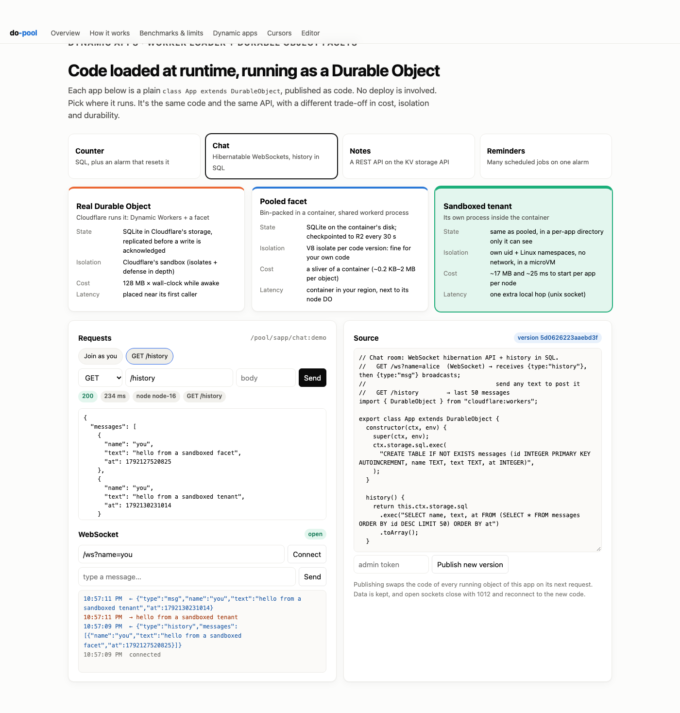

# Dynamic apps: examples

Plain Durable Object classes, published as code at runtime and run as **facets**: each object
gets its own SQLite database. Loading goes through the Worker Loader (Dynamic Workers), with no
deploy and no image rollout. The same code runs on three backends:

| backend | URL prefix | where it runs |
|---|---|---|
| real DO facet | `/do/app/<app>:<name>` | Cloudflare Durable Object + Dynamic Workers |
| pooled facet | `/pool/app/<app>:<name>` | workerd in a pool container, shared process |
| sandboxed | `/pool/sapp/<app>:<name>` | its own workerd process: own uid, all namespaces, no network |

| app | shows |
|---|---|
| [`counter.js`](apps/counter.js) | SQL, and an alarm that resets the count |
| [`notes.js`](apps/notes.js) | a REST API on the synchronous KV API |
| [`chat.js`](apps/chat.js) | WebSocket hibernation API, broadcast, history in SQL |
| [`reminders.js`](apps/reminders.js) | many scheduled jobs on one alarm (the pattern behind agent `schedule()`), pushed over a socket |

Try them in the playground: https://do-pool-v2.do-pool-lab.workers.dev/apps.html



```sh
ADMIN_TOKEN=... npm run publish:examples     # app id = file name
curl -X POST https://do-pool-v2.do-pool-lab.workers.dev/pool/app/counter:mine/inc
curl https://do-pool-v2.do-pool-lab.workers.dev/pool/sapp/notes:mine/notes
npm run test:examples                         # all four apps × all three backends
```

## Writing an app
- Export `class App extends DurableObject` (from `cloudflare:workers`).
- Routes are relative to the object: `/pool/app/counter:mine/inc` arrives as `/inc`.
- Everything in the DO API works, including alarms. Facets can't own alarms, so the host proxies
  them: `setAlarm` in the app sets the host's alarm, and the host's `alarm()` calls the app's.
- Apps get no network (`globalOutbound: null`) and no bindings. For an example that uses KV, R2,
  Workers AI, another Worker and another DO, see the AI chat rooms ([docs/bindings.md](../docs/bindings.md)).
  They're compiled-in classes rather than dynamic apps, because untrusted code shouldn't hold your bindings.
- Publishing a new version (`POST /api/code?app=<id>`, body = module source) swaps the code of
  running objects on their next request. Data is kept, and open WebSockets close with 1012 so
  clients reconnect to the new code.
